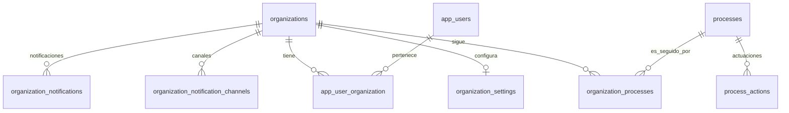

# Organizaciones, procesos y usuarios (app)

Documento de contexto sobre cómo se relacionan **organizaciones**, **procesos (radicados)** y **usuarios de la app** (`app_users`) en NotiJudicial.

## Idea central

- Una **organización** es el cliente del producto (bufete, centro de conciliación, abogado natural, etc.).
- Un **proceso** es el expediente judicial (fila maestra en `processes`). Es **compartido**: no pertenece a una sola organización.
- La relación “esta organización sigue / está interesada en este proceso” vive en la tabla pivote **`organization_processes`**.
- Los **usuarios de la app** (`app_users`) pertenecen a una o más organizaciones vía **`app_user_organization`**.

En la práctica:

| Pregunta | Respuesta |
|----------|-----------|
| ¿Una organización puede tener muchos procesos? | Sí, muchos vínculos en `organization_processes`. |
| ¿Un proceso puede tener varias organizaciones interesadas? | Sí, varias filas en `organization_processes` con el mismo `process_id`. |
| ¿Una organización tiene varios usuarios? | Sí, vía `app_user_organization`. |
| ¿Un usuario puede estar en varias organizaciones? | Sí (many-to-many). |

---

## 1. Organización (`organizations`)

**Modelo:** `Src\Domain\Organization\Models\Organization`  
**Tabla:** `organizations`

La organización es la unidad comercial y de permisos del producto. Sobre ella cuelgan:

- procesos que sigue (`organization_processes`);
- usuarios de la app (`app_user_organization`);
- cuota / límites (`organization_settings`);
- canales de notificación (email, WhatsApp, SMS, internal);
- keywords de alertas;
- notificaciones pendientes / digest (consolidados).

### Columnas relevantes

| Columna | Significado |
|--------|-------------|
| `id` | UUID |
| `name`, `slug` | Identidad (slug único) |
| `type` | `natural` o `juridical` |
| `identification`, `address`, `phone`, `email`, `contact_person` | Datos de contacto |
| `is_active` | Si la org está activa a nivel producto |
| `is_ai_enabled` | Flag de IA |
| `can_view_action_documents` | Si puede ver / recibir avisos de PDFs en actuaciones |

Si `organizations.is_active = false`, la org no debería recibir fan-out de alertas ni adjuntarse a procesos nuevos en flujos admin.

### Configuración 1:1 (`organization_settings`)

| Columna | Significado |
|---------|-------------|
| `organization_id` | FK única a `organizations` |
| `max_active_processes` | Tope de radicados activos (cuota); `null` = sin límite configurado |

La cuota cuenta radicados con vínculo `status = active` (ver más abajo).

---

## 2. Proceso (`processes`)

**Modelo:** `Src\Domain\Process\Models\Process`  
**Tabla:** `processes`

Es el expediente judicial (instancia). Datos típicos: `process_number` (radicado), `process_id` (id en Rama/SAMAI), juzgado, fechas, fuente (`process_data_sources`), flags de sync/privado, etc.

**Importante:** el proceso **no** tiene un `organization_id` dueño. El acceso y el seguimiento son solo por la pivote `organization_processes`.

Un mismo radicado puede aparecer como **varias filas** en `processes` (varias instancias / fuentes). Cada fila puede tener su propio conjunto de organizaciones interesadas.

Relaciones propias del proceso (globales, no por org):

- `process_actions` — actuaciones;
- sujetos, tareas, timeline, etc.

---

## 3. Organización ↔ proceso: “interesadas” (`organization_processes`)

**Modelo pivote:** `Src\Domain\OrganizationProcess\Models\OrganizationProcess`  
**Tabla:** `organization_processes`

Esta es la tabla clave. Cada fila dice:

> La organización X está interesada / hace seguimiento del proceso Y.

### Cardinalidad

- 1 organización → N filas (N procesos).
- 1 proceso → N filas (N organizaciones interesadas).
- Unicidad: `(organization_id, process_id)`.

### Columnas del vínculo

| Columna | Significado |
|--------|-------------|
| `id` | UUID de la fila pivote |
| `organization_id` | Org interesada |
| `process_id` | Proceso seguido |
| `interest_date` | Fecha en que empezó el seguimiento |
| `is_active` | Flag booleano de seguimiento “vivo” |
| `status` | `active` \| `inactive` \| `suspended` |
| `lawyer_role` | Rol de la org en ese proceso: `plaintiff` / `defendant` (nullable) |
| `inactivity_alert_level` | Semáforo de inactividad (nullable) |
| `deleted_at`, `deleted_by` | Soft delete del vínculo (no borra el proceso) |

### Estados del vínculo (`status`)

| Valor | Idea |
|-------|------|
| `active` | Org sigue el proceso; cuenta para cuota y sync/notificaciones |
| `inactive` | Dejó de seguirlo (o se desactivó) |
| `suspended` | Suspendido (p. ej. por cuota); sigue “vinculado” pero con reglas propias |

Notas:

- Al **quitar** una org de un proceso en admin, normalmente se hace soft delete del vínculo (`deleted_at`), no se elimina el `processes`.
- `OrganizationProcess::syncActiveLink()` crea o restaura el vínculo y lo deja activo.
- Para notificaciones de actuaciones, el fan-out mira orgs con `organizations.is_active` y pivote `is_active` (procesos activos para esa org).

### Cómo se crea el vínculo

- Registro desde la app (alta de radicado).
- Admin: adjuntar organizaciones a un proceso.
- Importaciones (Excel, SAMAI, manual / privado).

Todas terminan en algo equivalente a `syncActiveLink(organizationId, processId, …)`.

---

## 4. Usuarios de la app (`app_users`) y membresía

**Modelo:** `Src\Domain\AppUser\Models\AppUser`  
**Tabla:** `app_users`

Son los usuarios del frontend de clientes (distintos del admin Forge/`users`).

### Membresía: `app_user_organization`

| Columna | Significado |
|---------|-------------|
| `app_user_id` | Usuario app |
| `organization_id` | Organización |
| `is_owner` | Si es “dueño” / owner de esa org |
| `created_at`, `updated_at` | |

- Un usuario puede pertenecer a **varias** organizaciones.
- Una organización puede tener **varios** usuarios.
- En el pivote solo hay rol de membresía explícito: **`is_owner`** (boolean). No hay un enum rico de roles por org en esta tabla.

### Roles Spatie del usuario (globales)

Los roles de aplicación (`admin`, `customer`, etc. en Spatie, guard `app_user`) son **globales al usuario**, no por organización (`teams => false` en config de permisos).

### Qué ve un usuario

El usuario opera **en contexto de organización**: ve los procesos que esa org sigue (`organization_processes` no borrados / activos según el endpoint), no “todos los procesos del sistema”.

Middleware típico: el usuario debe pertenecer al menos a una organización activa (`EnsureAppUserOrganizationActive`).

---

## 5. Canales y notificaciones por organización

Las notificaciones de consolidado / digest / alertas son **por organización**, no por usuario individual (salvo el inbox personal de Laravel en algunos flujos).

### Destinos: `organization_notification_channels`

| Columna | Significado |
|---------|-------------|
| `organization_id` | Org |
| `channel_type` | `email`, `whatsapp`, `sms`, `internal` |
| `channel_value` | Destino (correo, número, `internal`, …) |
| `is_active`, `priority` | Activo y orden |

El preview del paquete de consolidados muestra estos canales por org.

### Cola / campana: `organization_notifications`

Registros pendientes o históricos de notificación para la org (morph a `ProcessAction`, tipos `actuacion`, `actuacion_alerta`, `actuacion_documento`, etc.), con flags `is_email_notified`, `notification_digest_id`, etc.

### Historial de envío por canal

`history_organizations_channels_notifications` — auditoría de entregas.

Detalle del flujo de consolidados: ver `docs/consolidados-notification-digests.md`.

---

## 6. Resumen de tablas

| Tabla | Rol |
|-------|-----|
| `organizations` | Cliente / entidad del producto |
| `organization_settings` | Cuota y settings 1:1 |
| `processes` | Expediente judicial (maestro compartido) |
| `organization_processes` | Quién sigue qué proceso + estados del vínculo |
| `app_users` | Usuarios de la app cliente |
| `app_user_organization` | Membresía usuario ↔ org (`is_owner`) |
| `organization_notification_channels` | Canales de salida de la org |
| `organization_notifications` | Notificaciones / digest por org |
| `process_actions` | Actuaciones del proceso (compartidas entre orgs interesadas) |

---

## 7. Ejemplo mental

1. Se crea la organización **“Sarria & Micolta Abogados”** en `organizations` (`is_active = true`).
2. Se crean usuarios en `app_users` y se vinculan en `app_user_organization` (uno con `is_owner = true`).
3. Se registra el radicado `76001400300120260083200` → existe (o se crea) una fila en `processes`.
4. Se inserta/restaura una fila en `organization_processes` (`status = active`, opcional `lawyer_role`).
5. Otra organización también puede interesarse en el **mismo** `process_id`: otra fila en `organization_processes`.
6. Cuando llega una actuación nueva, se guarda **una vez** en `process_actions`, y se crean notificaciones **por cada** organización interesada activa en `organization_notifications`.
7. El consolidado se arma y envía **por organización**, usando sus canales en `organization_notification_channels`.

---

## 8. Modelos Eloquent de referencia

| Concepto | Modelo |
|----------|--------|
| Organización | `Src\Domain\Organization\Models\Organization` |
| Settings | `Src\Domain\Organization\Models\OrganizationSetting` |
| Proceso | `Src\Domain\Process\Models\Process` |
| Vínculo org–proceso | `Src\Domain\OrganizationProcess\Models\OrganizationProcess` |
| Usuario app | `Src\Domain\AppUser\Models\AppUser` |
| Canal de notificación | `Src\Domain\Notification\Models\OrganizationNotificationChannel` |
| Notificación org | `Src\Domain\Notification\Models\OrganizationNotification` |

Estados del vínculo: `Src\Domain\OrganizationProcess\Enums\OrganizationProcessStatus`  
Rol en el proceso: `Src\Domain\Process\Enums\ProcessLawyerRole`
